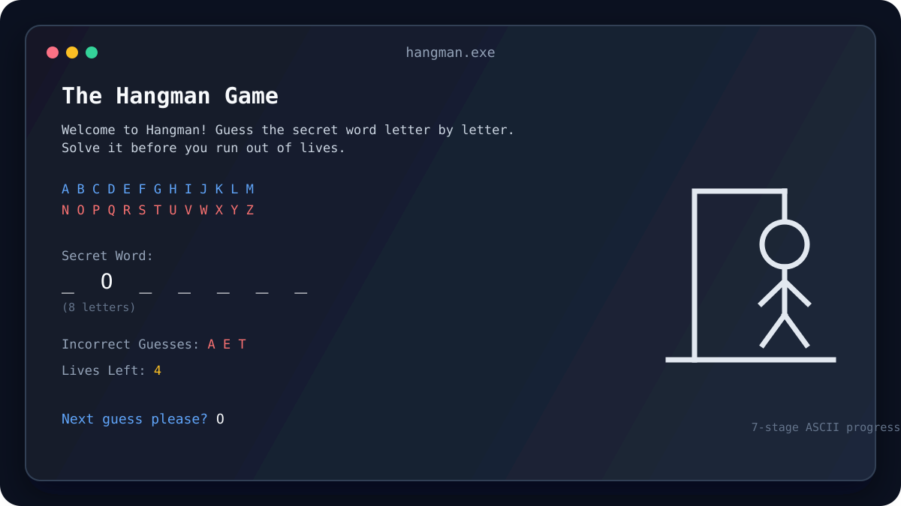

<div align="center">

# 🎯 Hangman

### A colorful, classic word-guessing game built in C++

Guess the hidden word one letter at a time, track your misses, and complete the hangman before your seven lives run out.

<p>
  
  
  
</p>



</div>

## ✨ What makes it fun

- **Randomized rounds** — a secret word is selected from `Words.txt` every round.
- **Helpful board** — see the alphabet, revealed letters, incorrect guesses, and lives remaining at a glance.
- **Classic ASCII art** — the hangman builds one stage at a time after each incorrect guess.
- **Replay loop** — finish a round and immediately start another without restarting the program.
- **Input-friendly guessing** — lowercase letters are accepted and repeated or invalid guesses are ignored.
- **Colorful Windows console UI** — cursor positioning and text colors keep the board easy to scan.

## 🕹️ How to play

1. Start the game.
2. Read the number of letters in the hidden word.
3. Enter one letter when prompted.
4. Reveal the word before all seven lives are used.
5. Choose `y` to play again or `n` to exit.

## 🧱 Project structure

| File | Purpose |
| --- | --- |
| `main.cpp` | Creates the game and starts the main loop |
| `Game.h / Game.cpp` | Word loading, guessing rules, win/loss state, and replay flow |
| `Hangman.h / Hangman.cpp` | Draws and resets the seven-stage ASCII hangman |
| `ConsoleFunctions.h / ConsoleFunctions.cpp` | Windows console colors, cursor movement, and input helpers |
| `Words.txt` | Word bank used to create randomized rounds |

## 🚀 Run locally

### Requirements

- Windows 10 or later
- A C++ compiler with Windows console support
- Visual Studio, or MinGW with `g++`

### Compile with MinGW

Run these commands from the project directory:

```bash
g++ -std=c++17 main.cpp Game.cpp Hangman.cpp ConsoleFunctions.cpp -o Hangman.exe
.\Hangman.exe
```

> **Important:** Keep `Words.txt` in the same directory as the executable. The game reads the word bank at runtime.

### Build with Visual Studio

1. Create a Console App project.
2. Add all `.cpp` and `.h` files to the project.
3. Set the language standard to **C++17** or newer.
4. Ensure `Words.txt` is copied beside the generated `.exe`.
5. Build and run.

## 🔁 Game flow

```text
Load words → Pick a secret word → Accept a letter
      ↑                         ↓
  Play again ← Win or lose ← Update the board
```

## 🛠️ Ideas for future rounds

- Difficulty levels with different word lengths and lives
- Categories for themed word banks
- Score tracking and streaks
- A cross-platform terminal layer
- On-screen keyboard selection

## 📄 License

No license has been specified yet. Add one before distributing the project publicly.

<div align="center">

**Made with C++ and a little courage.**

</div>
